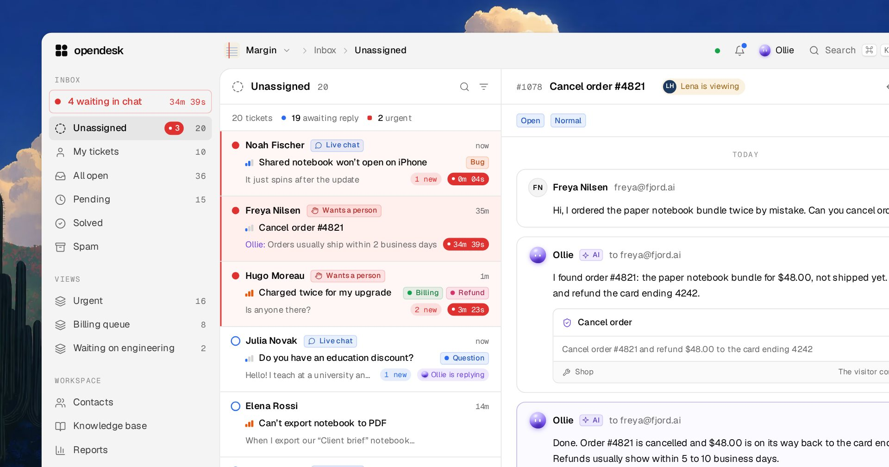
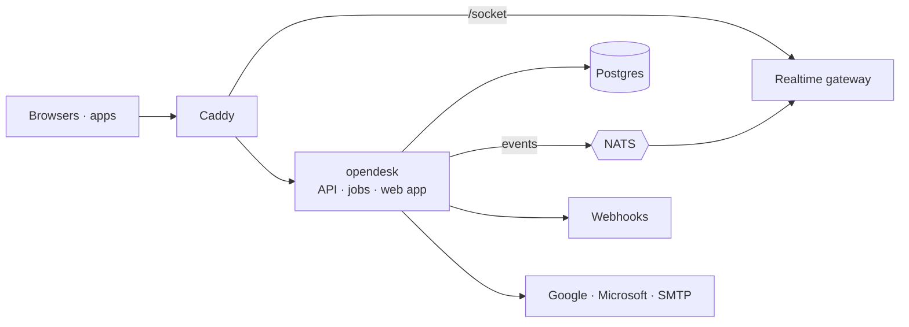

<div align="center">
  <picture>
    <source media="(prefers-color-scheme: dark)" srcset="brand/logo/lockup-white.svg">
    
  </picture>

  <p>The open-source helpdesk.</p>

  <p>
    <a href="https://opendesk.sh"></a>
    <a href="https://docs.opendesk.sh"></a>
    <a href="https://github.com/useopendesk/opendesk/actions/workflows/ci.yml"></a>
    <a href="./LICENSE"></a>
    <a href="https://dc.opendesk.sh"></a>
    <a href="https://x.opendesk.sh"></a>
  </p>

  <p>
    <a href="#features">Features</a> ·
    <a href="#how-it-works">How it works</a> ·
    <a href="#quick-start">Quick start</a> ·
    <a href="#self-hosting">Self-hosting</a> ·
    <a href="#documentation">Docs</a> ·
    <a href="#community">Community</a> ·
    <a href="#support">Support</a>
  </p>

  <p><i>⭐ Help more teams find opendesk. Star this repo!</i></p>
</div>

<p align="center">
  
</p>

## opendesk

opendesk brings your support email, live chat and help center into one shared
inbox, and every change shows up live for everyone on the team. It ships as a
hosted service at [opendesk.sh](https://opendesk.sh) and as a self-hosted
install, and **the two run the same code**. Ollie, the built-in AI, drafts,
triages and answers alongside your team, with any Anthropic or OpenAI-compatible
provider, including local models.

## Features

- **Shared inbox** - tickets with status, priority, assignee, team, tags and SLA; notes, merge, snooze, bulk edit
- **Mailboxes** - forward your support address in, reply from it through Google, Microsoft or SMTP
- **Live chat** - an embeddable widget with identity verification, typing and live delivery
- **Knowledge base** - collections and articles, published to a public help center
- **Ollie and bots** - drafts, summaries, triage, translation and chat answers from your knowledge base
- **Automations and SLAs** - rules that run on ticket events, and targets per priority
- **Reports and CSAT** - volume, response and resolution times, breaches and satisfaction
- **Integrations** - Linear, GitHub, Jira, Sentry, Slack, Stripe and any MCP server
- **Public API** - the REST API the app itself uses, plus signed webhooks, a realtime socket and MCP
- **Apps** - desktop for macOS, Windows and Linux, and a native iPhone app

## How it works

opendesk is one Go binary (the API, background jobs and the event relay), an
Elixir realtime gateway that holds no database connection, and Postgres. Every
change that someone else should see is written as an event in the same
transaction as the change; the relay publishes it to NATS, the gateway pushes it
to browsers, and webhooks deliver it to your endpoints. There is no Redis and no
Kafka.



Self-hosted, NATS runs embedded in the opendesk binary and the whole stack sits
behind Caddy on one domain. The hosted service splits the same binary into API
and worker roles. Full write-up in the
[introduction](https://docs.opendesk.sh/getting-started/introduction/) and the
[cloud architecture](https://docs.opendesk.sh/cloud/architecture/).

## Quick start

You need Go, Node.js with pnpm, Elixir, and Docker for Postgres.

```bash
git clone https://github.com/useopendesk/opendesk && cd opendesk
cp .env.example .env
make dev-db      # Postgres on localhost:55432
make api         # the Go API and workers, with embedded NATS on :4222
make realtime    # the Elixir gateway on :4000
make web         # the web app on :5173
```

Open `http://localhost:5173` and sign up. Until you configure a mail driver,
verification and invitation emails are printed to the API log. `make site` and
`make docs` run the marketing site and the docs. More in the
[contributing guide](https://docs.opendesk.sh/contributing/).

## Self-hosting

<a href="https://docs.opendesk.sh/self-hosting/"></a>

Self-hosted opendesk is free forever, with no limits, and runs the same code as
the hosted service. One command installs it on any Linux server with Docker:

```bash
curl -fsSL https://opendesk.sh/install.sh | sh
```

It asks for your domain and an email for the TLS certificate, generates every
secret, pins a release, verifies each file against the release's checksums,
and serves opendesk over HTTPS with Caddy. Open your domain and sign up; the
first account becomes the workspace owner. Add `--wizard` and it also asks about
email, storage, inbound mail, AI and sign-ups. The script is checksummed at
`install.sh.sha256` if you would rather read and verify it first, and
`--dry-run` prints the `.env` it would write without touching anything. Every
flag: [install script](https://docs.opendesk.sh/self-hosting/install-script/).

To build it from source instead:

```bash
git clone https://github.com/useopendesk/opendesk && cd opendesk
make selfhost-up
```

> [!WARNING]
> The installer writes `/opt/opendesk/.env`, which holds the only copy of
> `CREDENTIALS_KEY`, the key that encrypts mailbox credentials. Lose it and every
> stored credential is unreadable. `opendesk-ctl backup` saves it with the database.

`opendesk-ctl` in the install directory runs the instance: `status`, `logs`,
`backup`, `restore`, `upgrade`, `start` and `stop`. From here the
[self-hosting guide](https://docs.opendesk.sh/self-hosting/) covers email,
Google and Microsoft sign-in, storage, AI, hardening, scaling and backups.

## Documentation

The full docs live at **[docs.opendesk.sh](https://docs.opendesk.sh)**.

| Read this | To learn |
|-----------|----------|
| [What is opendesk](https://docs.opendesk.sh/getting-started/introduction/) | What you get, and how the parts fit together |
| [Cloud quickstart](https://docs.opendesk.sh/getting-started/quickstart-cloud/) | Your account, workspace, first mailbox and chat widget on opendesk.sh |
| [Self-host quickstart](https://docs.opendesk.sh/getting-started/quickstart-self-host/) | A server, a domain and one command to a running instance |
| [Install script](https://docs.opendesk.sh/self-hosting/install-script/) | What the installer does, every flag, and how to verify it first |
| [Configuration](https://docs.opendesk.sh/self-hosting/configuration/) | Every environment variable opendesk and the gateway read |
| [Email](https://docs.opendesk.sh/self-hosting/email/) | Inbound forwarding, outbound replies and platform email |
| [Backups and upgrades](https://docs.opendesk.sh/self-hosting/backups-and-upgrades/) | Backing up, restoring and moving between releases |
| [Hardening](https://docs.opendesk.sh/self-hosting/hardening/) | A checklist for running opendesk securely on your own infrastructure |
| [Scaling](https://docs.opendesk.sh/self-hosting/scaling/) | Splitting into API, worker and gateway roles, with an external NATS cluster |
| [Mailboxes](https://docs.opendesk.sh/guides/mailboxes/) | Forwarding your address in and replying from it |
| [API reference](https://docs.opendesk.sh/api/) | Endpoints, auth, webhooks, events, realtime and MCP |

## Community

Have a question, found a bug, or want to shape where opendesk goes next?

- **[Discord](https://dc.opendesk.sh)** - ask questions, share what you built and talk to the team
- **[X (@OpendeskHQ)](https://x.opendesk.sh)** - news, releases and what we are working on
- **[GitHub Issues](https://github.com/useopendesk/opendesk/issues)** - report bugs and request features
- **[Releases](https://github.com/useopendesk/opendesk/releases)** - follow along for new versions
- **Email** - reach us at `team@opendesk.sh`

## Support

> [!NOTE]
> <i>**Need a hand? We are happy to help.** Ask in [Discord](https://dc.opendesk.sh), open a [GitHub issue](https://github.com/useopendesk/opendesk/issues) or email `team@opendesk.sh`, and someone on the team will get back to you.</i>
>
> <i>**Would you rather not run it yourself?** [opendesk Cloud](https://opendesk.sh) is the same code, hosted and operated by us. For larger teams we also help with migrating from another helpdesk, self-hosted deployments and support agreements. Tell us what you need at `team@opendesk.sh`.</i>

<p>
  <a href="https://opendesk.sh"></a>
  <a href="mailto:team@opendesk.sh"></a>
  <a href="https://dc.opendesk.sh"></a>
</p>

## Contributing

Pull requests are welcome. Keep each one to a single logical change, and open an
issue first for larger design or product changes. Read [`AGENTS.md`](AGENTS.md)
and the files in [`contracts/`](contracts/) before changing an interface between
parts. Before you open a PR, run `make lint` and `make test` for Go, and
`pnpm typecheck` and `pnpm lint` in `web/`. See the
[contributing guide](https://docs.opendesk.sh/contributing/).

Logos, icons, colours and usage rules are in [`brand/`](brand/README.md).

## Security

Found a vulnerability? Email `team@opendesk.sh` or open a
[private advisory](https://github.com/useopendesk/opendesk/security/advisories/new)
instead of a public issue. See
[responsible disclosure](https://docs.opendesk.sh/security/disclosure/).

## License

Apache License 2.0. Copyright 2026 Mindroot Ltd. See [LICENSE](./LICENSE).
